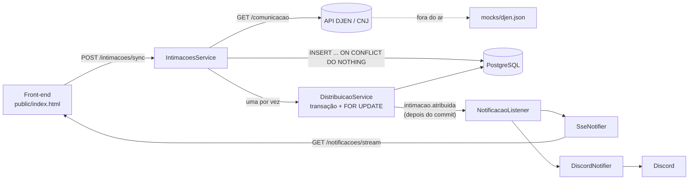

# Intimações DJEN

Sistema que busca intimações na API pública do **DJEN/CNJ**, salva **sem duplicar**, distribui cada uma para o **colaborador com a menor fila** e avisa a equipe **em tempo real** no navegador (SSE + notificação push).

> Desenvolvido em um hackathon individual de 4 horas. Critérios avaliados: segurança, API bem estruturada e front-end com notificação em formato push.

## Sumário

- [O que ele faz](#o-que-ele-faz)
- [Stack](#stack)
- [Como funciona](#como-funciona)
- [Como rodar](#como-rodar)
- [Variáveis de ambiente](#variáveis-de-ambiente)
- [API](#api)
- [Decisões técnicas](#decisões-técnicas)
- [Segurança](#segurança)
- [Testes](#testes)
- [Estrutura de pastas](#estrutura-de-pastas)
- [Próximos passos](#próximos-passos)

## O que ele faz

1. **Sincroniza** com o DJEN (`GET https://comunicaapi.pje.jus.br/api/v1/comunicacao`) por tribunal ou por OAB, página por página.
2. **Salva sem duplicar**, usando o `id` do DJEN como chave única no banco.
3. **Distribui** cada intimação nova para quem tem menos pendências. Em caso de empate, vai para o menor id.
4. **Avisa** a equipe a cada atribuição: toast animado, destaque no card e notificação do sistema operacional. Opcionalmente, também pelo Discord.
5. **Aguenta o DJEN instável**: timeout alto, novas tentativas em erro 5xx, espera em 429 e fallback para um mock local.

## Stack

| Camada | Tecnologia |
|---|---|
| Backend | NestJS 12 + TypeScript (ESM) |
| Banco | PostgreSQL 16 (Docker) + TypeORM |
| Tempo real | Server-Sent Events (`@Sse`) + `@nestjs/event-emitter` |
| Front-end | HTML + CSS + JavaScript puro, em um arquivo só, servido pelo próprio Nest |
| Segurança | `helmet`, `@nestjs/throttler`, `class-validator` |
| Testes | Vitest + Supertest |

**Por que SSE e não WebSocket?** O fluxo é só servidor → navegador. O SSE é HTTP comum, reconecta sozinho e não precisa de biblioteca no front.

## Como funciona



O caminho de uma sincronização:

1. O front envia o tribunal e a data para `POST /intimacoes/sync`.
2. O `DjenClient` busca as páginas em sequência. Se o DJEN falhar de vez, usa o mock.
3. Cada item é validado e convertido. As novas entram no banco, e as repetidas são ignoradas pelo próprio Postgres.
4. Para cada intimação nova, a `DistribuicaoService` escolhe a menor fila e grava a atribuição dentro de uma transação.
5. Depois do commit, sai o evento `intimacao.atribuida`. O listener avisa todos os canais ligados, e o navegador recebe pelo SSE.

## Como rodar

**Pré-requisitos:** Node.js 24 e Docker.

```bash
git clone https://github.com/emnlfrnds/intimacoes-djen.git
cd intimacoes-djen
npm install
cp .env.example .env
```

No `.env`, troque o `DB_PASS` e preencha a `API_KEY` com uma chave aleatória. Para gerar uma:

```bash
node -e "console.log(require('crypto').randomBytes(32).toString('hex'))"
```

Suba o banco e a aplicação:

```bash
npm run db:up
npm run start:dev
```

Abra **http://localhost:3000**, entre com a `API_KEY` e clique em **Sincronizar agora**. As tabelas são criadas sozinhas, e o seed cadastra 4 colaboradores fictícios.

### Teste rápido

1. **Entrar:** a bolinha do topo fica verde ("Conectado").
2. **Ativar notificações:** aceite o pedido do navegador.
3. **Sincronizar** `TJSP` em um dia útil recente com 10 itens: os cards chegam destacados e a menor fila aumenta.
4. **Sincronizar de novo** a mesma data: aparece "0 novas · 10 já existiam", ou seja, nada foi duplicado.
5. **Concluir** um card: a fila daquele colaborador diminui.
6. **Derrubar o DJEN:** coloque `DJEN_BASE_URL=http://127.0.0.1:9` no `.env`, reinicie e sincronize. Os dados vêm do mock, e o item `0000001-…` mostra um `` **como texto**, que é a prova contra XSS.

## Variáveis de ambiente

| Variável | Padrão | Descrição |
|---|---|---|
| `PORT` | `3000` | Porta HTTP |
| `DB_HOST` / `DB_PORT` | `localhost` / `5435` | Postgres (o `docker-compose.yml` usa as mesmas variáveis) |
| `DB_USER` / `DB_PASS` / `DB_NAME` | — | Credenciais do banco |
| `DJEN_BASE_URL` | `https://comunicaapi.pje.jus.br/api/v1` | Endereço da API do DJEN |
| `DJEN_TIMEOUT_MS` | `30000` | Timeout de cada chamada ao DJEN |
| `DJEN_FALLBACK_MOCK` | `true` | Se o DJEN falhar, usa `mocks/djen.json` |
| `NOTIFICACAO_CANAIS` | `sse` | Canais de alerta separados por vírgula: `sse`, `discord` |
| `DISCORD_WEBHOOK_URL` | vazio | Webhook do Discord (só se o canal `discord` estiver ligado) |
| `API_KEY` | **obrigatória** | Chave de acesso. O app não sobe com menos de 32 caracteres |
| `CORS_ORIGENS` | `http://localhost:3000` | Origens liberadas no CORS, separadas por vírgula |

## API

Todas as rotas, exceto `/` e `/auth/*`, exigem uma das duas credenciais:

- o header `x-api-key: <API_KEY>`, para scripts, curl e Postman;
- o cookie de sessão `djen_sessao`, que o navegador recebe no login.

| Método | Rota | Limite | Descrição |
|---|---|---|---|
| `GET` | `/` | — | Front-end |
| `POST` | `/auth/sessao` | 5/min | Troca a API key por um cookie `HttpOnly` (204) |
| `POST` | `/auth/sair` | — | Apaga o cookie (204) |
| `GET` | `/colaboradores` | 120/min | Colaboradores com o número de pendentes |
| `POST` | `/intimacoes/sync` | **6/min** | Busca no DJEN, salva e distribui |
| `POST` | `/intimacoes/distribuir-pendentes` | 120/min | Distribui as que ficaram sem dono |
| `GET` | `/intimacoes` | 120/min | As 50 mais recentes |
| `PATCH` | `/intimacoes/:id/concluir` | 120/min | Marca como concluída |
| `GET` | `/notificacoes/stream` | 120/min | Stream SSE com o evento `intimacao.atribuida` |

### `POST /intimacoes/sync`

```json
{
  "siglaTribunal": "TJSP",
  "dataDisponibilizacaoInicio": "2026-10-30",
  "dataDisponibilizacaoFim": "2026-10-30",
  "itensPorPagina": 100,
  "maxPaginas": 5
}
```

- **Filtro obrigatório:** mande `siglaTribunal` **ou** `numeroOab` + `ufOab`.
- **Padrões:** as datas assumem hoje (fuso de Brasília), `itensPorPagina` 100 (máximo 100) e `maxPaginas` 5 (máximo 20).
- **Campos desconhecidos** são recusados com `400`.

Resposta:

```json
{ "origem": "api", "paginas": 1, "recebidas": 10, "novas": 10,
  "duplicadas": 0, "invalidas": 0, "atribuidas": 10 }
```

`origem` vira `"mock"` quando o DJEN estava fora e o fallback foi usado.

### Exemplo com curl

```bash
curl -X POST http://localhost:3000/intimacoes/sync \
  -H "x-api-key: $API_KEY" -H "Content-Type: application/json" \
  -d '{"siglaTribunal":"TJSP","itensPorPagina":10,"maxPaginas":1}'
```

## Decisões técnicas

### Sem duplicadas

O `id` de cada comunicação do DJEN vira a coluna `djenId`, com constraint `UNIQUE`. O insert usa `ON CONFLICT DO NOTHING ... RETURNING id`: o próprio Postgres descarta as repetidas, inclusive com dois syncs ao mesmo tempo, e devolve só as que entraram. Nada de "consultar antes de inserir", que tem condição de corrida.

> O UNIQUE é no id do DJEN, **não** no número do processo: um mesmo processo recebe várias comunicações.

### Menor fila, empate e concorrência

- **Critério:** `ORDER BY COUNT(pendentes) ASC, colaborador.id ASC`. O empate vai para o menor id, um critério previsível.
- **Escolha e gravação na mesma transação**, que começa travando os colaboradores ativos (`SELECT ... FOR UPDATE`). Um segundo sync simultâneo espera o commit e só então conta as filas. A trava fica numa query separada da contagem porque o Postgres não aceita `FOR UPDATE` junto com `GROUP BY`.
- **`UPDATE ... WHERE "colaboradorId" IS NULL`:** se duas chamadas pegarem a mesma intimação, só a primeira atribui.
- **`for...of` com `await`, e não `Promise.all`:**
  - cada escolha depende da fila que a anterior acabou de gravar;
  - em paralelo, as transações ficariam numa fila de espera em ordem imprevisível;
  - e cada uma seguraria uma conexão do pool.
- **O evento só sai depois do commit:** um rollback nunca gera alerta falso.

Testado com 3 chamadas simultâneas sobre as mesmas 30 intimações: 10 para cada colaborador, nenhuma atribuída duas vezes.

### DJEN instável

| Situação | O que acontece |
|---|---|
| Timeout ou falha de rede | Nova tentativa após 1s e depois 2s (backoff exponencial, 3 tentativas) |
| HTTP 5xx | Igual |
| HTTP 429 | Espera o `Retry-After` (em segundos ou como data). Se não vier, 60s. Teto de 2 min |
| HTTP 4xx | Responde `400` na hora, porque repetir não adianta |
| Falhou de vez | Usa `mocks/djen.json` e avisa com `"origem": "mock"` |

As páginas são buscadas uma por vez, com um teto de páginas: um único dia do TJSP passa de 10 mil comunicações.

### Notificações desacopladas

A distribuição só emite `intimacao.atribuida`. Quem avisa é uma lista de `Notifier`s, todos com a mesma interface:

```ts
interface Notifier {
  readonly nome: string;
  enviar(evento: IntimacaoAtribuidaEvent): Promise<void>;
}
```

- **Trocar ou somar canal é só configuração** (`NOTIFICACAO_CANAIS=sse,discord`). A regra de negócio não muda.
- **Os canais rodam em paralelo** (`Promise.allSettled`): o Discord fora do ar não impede o push no navegador.

## Segurança

| Medida | Detalhe |
|---|---|
| **Fechado por padrão** | Guard global exige credencial. Só rotas marcadas com `@Publico()` ficam abertas |
| **API key** | Comparada em tempo constante (`timingSafeEqual`). O app não sobe com chave fraca |
| **Sessão por cookie** | `HttpOnly` + `SameSite=Strict`, token assinado com HMAC e validade de 8h, sem estado no servidor |
| **Validação** | `ValidationPipe` global com `whitelist` + `forbidNonWhitelisted`. DTOs com `class-validator` |
| **Helmet + CSP** | CSP **sem** `'unsafe-inline'`: o `<script>` e o `<style>` do front são liberados pelo hash SHA-256, calculado no boot |
| **CORS restrito** | Só as origens de `CORS_ORIGENS` |
| **Rate limit** | 120/min por IP, 6/min no sync, 5/min no login (contra força bruta) |
| **XSS** | O texto do DJEN chega como HTML. O front usa **sempre `textContent`**, nunca `innerHTML`. A API devolve só um trecho em texto puro, e links só passam se forem `https://` |
| **Discord** | `allowed_mentions: { parse: [] }`: um texto com `@everyone` não pinga o servidor |
| **Logs** | A URL do DJEN não vai para o log, porque carrega o número da OAB |
| **LGPD** | O mock versionado foi anonimizado (`scripts/anonimizar-mocks.mjs`) |

### A limitação do EventSource

O `EventSource` do navegador **não permite enviar headers**, então não dá para mandar `Authorization: Bearer` nem `x-api-key` no SSE. As alternativas:

- **Token na URL:** vaza em logs, no histórico e no `Referer`.
- **Reimplementar o SSE com `fetch`:** perde a reconexão automática.
- **Cookie de sessão:** é a escolha deste projeto. O navegador envia sozinho para o mesmo site, e o `HttpOnly` impede que um XSS leia a sessão.

## Testes

```bash
npm test           # unitários: sessão/token, extração de trecho, filtro de link
npm run test:e2e   # sobe o app de verdade (precisa do Postgres: npm run db:up)
npm run lint
```

Os testes e2e cobrem: 401 sem credencial, 200 com a API key, login gerando cookie `HttpOnly`/`SameSite=Strict` aceito nas rotas, e validação do corpo do sync.

## Estrutura de pastas

```
├── mocks/djen.json               resposta real do DJEN, anonimizada (fallback)
├── public/index.html             front-end completo (HTML + CSS + JS)
├── scripts/anonimizar-mocks.mjs  troca dados pessoais do mock por fictícios
├── src/
│   ├── main.ts                   helmet/CSP, CORS, ValidationPipe, arquivos estáticos
│   ├── app.module.ts             módulos e validação do .env
│   ├── djen/                     cliente HTTP: timeout, retry, 429, fallback
│   ├── intimacoes/               entidade, sync, listagem, visão pública
│   ├── colaborador/              entidade, seed, filas
│   ├── distribuicao/             menor fila em transação com trava
│   ├── notificacao/              interface Notifier, SSE, Discord, listener
│   └── seguranca/                API key, sessão, CSP, rate limit
├── test/app.e2e-spec.ts
└── docker-compose.yml
```

## Próximos passos

- **Usuários de verdade (JWT)**, em vez de uma única API key compartilhada, com revogação de sessão.
- **CRUD de colaboradores** (cadastrar, ativar e desativar). Hoje só existe a listagem.
- **Paginação e filtros** no `GET /intimacoes`.
- **Migrations** no lugar do `synchronize: true`.
- **Sync agendado** (cron) e em fila (ex.: BullMQ), para não prender uma requisição HTTP.
- **Reenvio de eventos perdidos** no SSE via `Last-Event-ID`.
- **Documentação OpenAPI** com `@nestjs/swagger`.
